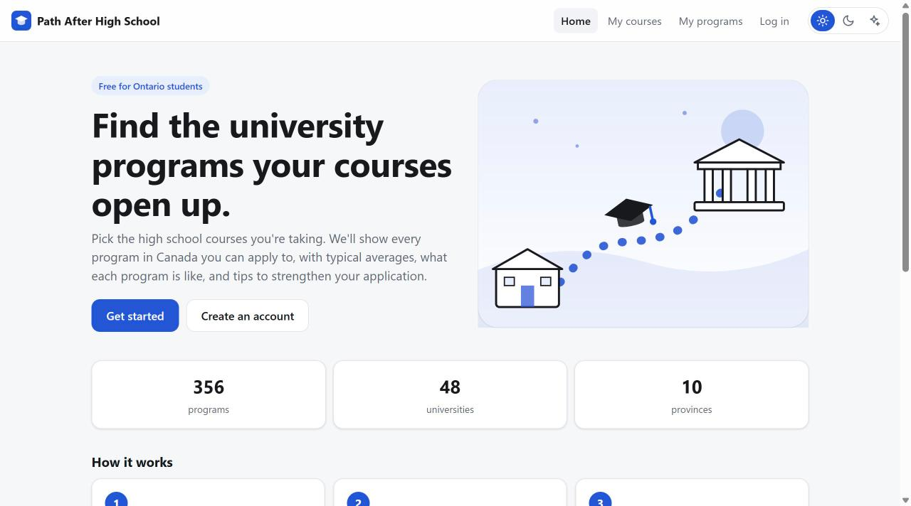
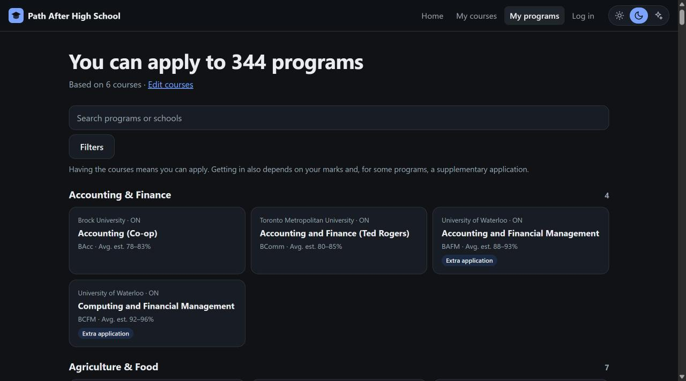
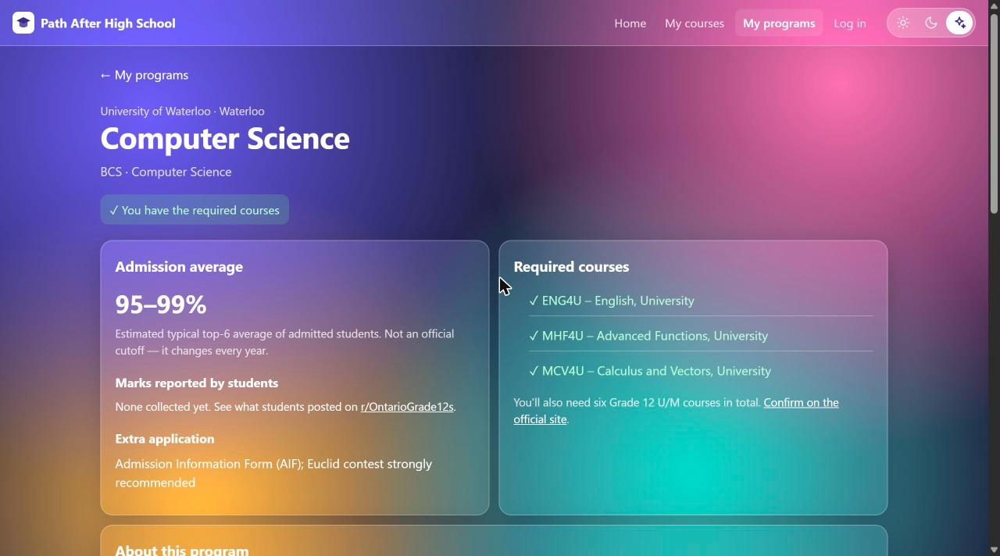

# Path After High School

**Find every Canadian university program your Ontario high school courses let you apply to.**

🔗 **Live site: [path-after-highschool.vercel.app](https://path-after-highschool.vercel.app)**



Choosing university programs is confusing. Every school lists prerequisites differently, and it's hard to see the full picture of what your courses actually open up. Path After High School lets a student tick the courses they've taken and instantly see every program they meet the requirements for, grouped by major, with typical admission averages, what the program is like, where it leads, and ideas to strengthen their application.

It's free, works on any phone, and doesn't need an account.

---

## Features

| | |
| --- | --- |
| **Course picker** | Search 224 Ontario secondary courses by code or name, filter by grade and subject, or tap the most common prerequisites in one click. |
| **Program matcher** | See every program you're eligible for, grouped by major, and filter by province, university or field. Optionally show programs you're one course away from. |
| **Program pages** | Required courses (with ✓/✗ against yours), estimated admission average, supplementary application info, program overview, career paths, and university details: location, size, setting and student life. |
| **Extracurricular ideas** | A "Best supplementary extracurriculars" button with activities that strengthen applications in each field. |
| **Three themes** | Light, dark and a frosted-glass "blur" theme, remembered per device. |
| **Mobile-first** | Bottom navigation, large tap targets and a sticky course tray, built for phones. |
| **Optional accounts** | Sign up to save your courses across devices. Delete your account and data any time. |

<p>
  
  
</p>

## Coverage

- **356 programs** at **48 universities** across all **10 provinces**
- **224 Ontario high school courses** (Grades 9–12, all subject areas)
- For universities outside Ontario, requirements are shown as the Ontario courses an Ontario applicant needs.

The focus is on the main undergraduate programs at each school. More programs will be added over time.

## How it works

1. Each program lists **required courses** (you need all of them) and **course groups** (you need *n* courses from a list, e.g. "1 of MHF4U, MCV4U, MDM4U").
2. The site checks your selected courses against every program and shows the ones you qualify for.
3. Programs you're missing exactly one requirement for can be shown separately, with the missing course named.

Everything runs in the browser. Course selections are stored on the device, or in your account if you're signed in.

## Tech

- Plain **HTML, CSS and JavaScript**, with no framework and no build step
- **Firebase Authentication** and **Cloud Firestore** for optional accounts
- Hosted on **Vercel**

```
├── index.html            Page shell, header, navigation
├── app.js                Views, routing, matching logic
├── styles.css            Layout and the three themes
├── theme-init.js         Applies the saved theme before first paint
├── auth.js               Firebase sign-up / login / saved courses
├── auth-config.js        Public Firebase project config
├── vercel.json           Security headers
└── data/
    ├── courses.js              Ontario course catalogue
    ├── fields.js               Majors: descriptions, careers, extracurricular ideas
    ├── universities.js         Ontario universities
    ├── universities-canada.js  Universities in other provinces
    ├── programs.js             Ontario programs and prerequisites
    ├── programs-canada.js      Other provinces' programs and prerequisites
    └── community.js            Student-reported data (each entry needs a source link)
```

## Run it locally

```bash
python -m http.server 8000
```

Then open http://localhost:8000.

## Adding or fixing a program

Programs are one line each in `data/programs.js` or `data/programs-canada.js`:

```js
P("waterloo", "Computer Science", "BCS", "cs", ["ENG4U", "MHF4U", "MCV4U"], [], [95, 99]);
//  uni id     program name       degree field  required courses          groups  est. average
```

Groups look like `[[1, ["MHF4U", "MCV4U", "MDM4U"]]]`, meaning "at least 1 of these".

## Security & privacy

- A Content Security Policy only allows the site's own scripts and the Firebase SDK. Pages can't be embedded by other sites.
- All displayed data is HTML-escaped, and data-driven links only allow `http`/`https`.
- Firestore rules restrict each user to their own document:

```
rules_version = '2';
service cloud.firestore {
  match /databases/{database}/documents {
    match /users/{uid} {
      allow read, write: if request.auth != null && request.auth.uid == uid;
    }
  }
}
```

- No ads, no tracking analytics. See the site's Privacy page for details.

## Disclaimer

This is an independent student resource. It is **not affiliated with** any university, the Ontario Universities' Application Centre (OUAC) or the Ontario government. Admission requirements change every year, and **admission averages shown are estimates, not official cutoffs**. Always confirm details on each university's official website and with a guidance counsellor before applying. University names and course codes are used only to identify them; all trademarks belong to their owners.
